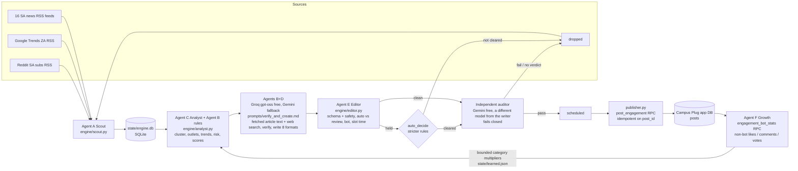

# Campus Plug trend desk

The trend desk finds South African news and social-media trends and checks each story against its sources. It then writes original posts for students and publishes them to the Campus Plug app feed through three engagement bots. It runs on this machine from cron, next to the other Campus Plug automations, and uses the existing app database (`oknfncjoqsepmyfoegob`).

| Bot | Account | Covers |
|---|---|---|
| Ayanda Nkosi · Campus Plug News Desk | `ayanda.bot@campusplug.com` | news, public affairs, safety, cost of living, education, NSFAS, jobs |
| Lwazi Mthembu · Campus Plug Sports & Culture | `lwazi.bot@campusplug.com` | football, rugby, cricket, music, entertainment |
| Naledi Khumalo · Campus Plug Trending | `naledi.bot@campusplug.com` | viral, tech, youth culture, relationships, student life |

All three accounts are `is_bot = true` and are tagged `bot_persona = 'trend_desk'`, so the old random-chatter function never posts as them. The bots only post. They never comment, like or vote, so none of the engagement the system measures is fake.

## Stage 1 audit: what already existed and what this reuses

| Existing piece | Reused how |
|---|---|
| App DB `posts` (content, image_url, `poll_options jsonb`), `likes`, `comments`, `poll_votes` | Posts are inserted into `posts`. Engagement is read from likes, comments and poll_votes, counting only users who are not bots. `like_boost` is ignored. |
| Token-gated SECURITY DEFINER RPC pattern (`post_opportunity`, 005) | The same pattern is used for `post_engagement` and `engagement_bot_stats` (008). No service-role key is stored anywhere. |
| Social Radar source findings (`campusplug-social-agent`) | The tested access rules carry over: Reddit RSS only, trends24 for X, Google Trends RSS. TikTok, Instagram and Facebook are unavailable without credentials. |
| Editorial bots' free Groq gpt-oss + search setup (004) | Verification and writing run on **free tiers only**, as fallback chains in `config.json` → `llm.models`. Groq: `gpt-oss-120b` → `gpt-oss-20b` (both with built-in browser search) → `qwen3.8-27b`. Gemini: `gemini-flash-latest` → `3.8` → `3.7` → `3.6` → `3.5-flash` → `flash-lite-latest` → `3.5-flash-lite` → `gemma-4-26b` → `gemma-4-31b`. A model that hits its free limit is skipped for 15 minutes and the next one is used. Lite, Gemma and Qwen models may write but never audit. Gemini's Google Search grounding has no free quota, so models without search get Google News search results pasted in. Never `claude -p`, never a paid API. |
| `qconnec-mail/cron_sender.py` | Sends the daily review email and the weekly growth email from campusplug.qconnec@gmail.com. |
| Editorial bots (004/007) and opportunity bots (005) | Not touched. The trend desk is a separate set of accounts with its own daily cap. |

The app's Flutter source is not on this machine. Whether the app renders native polls, and which `poll_options` format it expects, cannot be checked; no existing post has ever used `poll_options`. Polls are therefore written as text (`A) … B) …`, "drop your letter in the comments") until `native_polls` is set to true in `config.json`.

## Architecture



The loop runs DISCOVER → DEDUPLICATE → VERIFY → SCORE → GENERATE → REVIEW → PUBLISH → MEASURE → LEARN.

Why a local SQLite store and not tables in the app DB: changing the production DB needs the owner to paste SQL into the dashboard. Discovery data is bulky and specific to the engine, so it stays local. Only finished posts cross into production, through one narrow RPC.

## Schedule (crontab, SAST)

| When | Job | LLM? |
|---|---|---|
| 06:30 / 11:30 / 15:00 / 18:30 | `run.sh slot morning / midday / afternoon / evening`: scout, score, pick 6, verify and write, edit, audit, schedule | yes, free Groq + Gemini (~1 call per candidate + 1 per audited post) |
| hourly :40, 06:40–22:40 | `run.sh scout`: Agent A only, builds trend-velocity history | no |
| every 10 min, 07:00–22:50 | `run.sh publish`: posts whatever is due | no |
| 21:30 | `run.sh report daily`: FYI email with what was published, what was dropped automatically and why, and source health. No action needed. | no |
| Mon 08:00 | `run.sh report weekly`: Agent F metrics, comparisons, bounded learning | no |

Each slot targets 5 candidates, so the day produces about 20, in line with the 12–20 brief. Posts in a slot are published 25 minutes apart, in the numbers set per slot in `config.json` (morning 3, midday 3, afternoon 2, evening 3, so at most 11 auto-published a day). Candidates over the quota are stored as `spare` and never published. The database caps the trend desk at 30 posts a day.

## Scoring

The six components are stored separately on every post. The weights are configurable in `config.json` and are not measured results:

| Component | Weight | Data behind it |
|---|---|---|
| freshness | 0.20 | age of the newest item, against `max_story_age_hours` (36) |
| momentum | 0.20 | independent outlets beyond the first, matching live Google Trends and X topics, Reddit mentions, and how fast outlets picked it up. With no trend data, `trend_data` is set to "unavailable". |
| student_relevance | 0.20 | student and youth keywords (NSFAS, campus, TVET, exams, campuses…) |
| sa_relevance | 0.15 | whether the source is SA, plus SA keywords |
| engagement_potential | 0.15 | base rate per category (a starting guess, replaced by the learned multipliers over time) |
| credibility | 0.10 | source tier, or official source |

Hard rejections can't be overridden by a high score:
- the story is stale
- only social chatter supports it (no news source)
- a high-risk claim has only one source
- it's low-value (lotto, previews, live blogs, ads)
- it fails the fact-check
- the verification is disputed or unverified
- it copies 13 or more consecutive words from a source
- the source domain isn't on the credible list
- a tragedy story is turned into a poll, joke or quiz
- the same topic was already used in the last 5 days (40% shared key words, or 4+ shared words, against earlier stories and the headlines actually posted).

**There is no manual review.** Every post the editor would have held is decided by `editor.auto_decide`:

| Case | Automatic decision |
|---|---|
| Tragedy, allegation, or any high-risk story (deaths, crime suspects, courts, elections, health scares, race/religion/nationality) | always dropped |
| Medium-risk politics or safety | published only with 2+ independent outlets, confidence ≥ 0.85 and a neutral format (summary, explainer or discussion; no polls or jokes) |
| Single source | only for low-risk sport, music, entertainment, tech, campus or viral stories from a tier-1/2 outlet with confidence ≥ 0.85. Money, grant, deadline or job facts need 2+ outlets or an official source. |
| Confidence < 0.75 | dropped |
| Direct quote with only one source | dropped |

Everything that survives then goes to the **independent auditor** (`prompts/audit.md`): a different free model from the one that wrote the post re-reads the fetched article text, runs a web search, and checks every sentence of the exact feed text. If only the writer's model is available, nothing is audited, so nothing is published. Any doubt means fail. If the audit times out or returns nothing, nothing is published that slot (fail closed). If 60% or more of a slot's shortlist fails the audit, the circuit breaker skips the whole slot. Create `state/PAUSE` to stop all publishing instantly.

## Community desk (replaces the editorial-bot edge function, 2026-10-18)

The five personas, Thandi (study), Sibusiso (careers), Lerato (money), Kabelo (future skills) and Zanele (campus life), post **engagement content all day** from `engine/community.py`: polls, this-or-that, hot takes, fill-the-blank, challenges, quizzes, confessions and advice swaps. Every post ends with an invitation to reply.

- **06:15** `run.sh community am` writes 3 per persona and keeps 2 that pass, spread over 07:00–14:00. **12:45** `run.sh community pm` does the same for 14:00–21:15. That's about 20 posts a day, roughly every 40 minutes, rotating voices.
- **No time-sensitive facts.** No dates, deadlines, rand amounts, statistics, news or claims about named people. News belongs to the trend desk; deadlines and apply links belong to the opportunity bots (Nomvula, Tshepo).
- Written by a free Groq model (Gemini fallback) and reviewed in one batch by a model from the **other** provider (`prompts/community_audit.md`). The review also rejects boring posts and posts with no call to respond. No verdict means rejected.
- Posts are published by the same `publisher.py` through `post_engagement`. Migration 010 allows the 5 personas, with caps of 12 a day per bot and 90 a day overall.
- The old edge function's cron jobs and its human review queue (`bot_content` needs_review) are retired by `010_retire_editorial_bot_community_desk.sql`.

## Install / deploy

1. **Database (one time).** Open the Supabase SQL editor for the Campus Plug project. Paste `~/claude-code/campus-plug/campusplug-app-db/008_engagement_bots.sql` and click **Run**. The check row should read `3 engagement bots | rpcs: post_engagement, engagement_bot_stats`. To undo it, run `008_rollback.sql`.
2. **Token.** `CAMPUSPLUG_TREND_BOT_TOKEN` is already in `~/.config/campusplug/app.env` (mode 600). Only its SHA-256 is stored in 008.
   **Free LLM keys.** Put `GROQ_API_KEY` (console.groq.com/keys) and `GEMINI_API_KEY` (aistudio.google.com/apikey) in `~/.config/campusplug/llm.env` (mode 600). Both are free tiers. Without them the slots write nothing and publish nothing.
3. **Cron.** Add the block from `crontab.txt` with `crontab -e`.
4. **Pilot.** Run `python3 run.py sample`. It verifies and writes a full day without publishing anything, into `out/sample-day-<date>.md`.

Requirements: Python 3.11+, `requests`, `jsonschema`, and the two free keys above.

## Operating it

```bash
cd ~/claude-code/campus-plug/campusplug-trend-bots
touch state/PAUSE                     # stop all publishing (rm to resume)
python3 run.py review show <id>       # optional: inspect any post's text, verification and sources
python3 run.py slot midday --dry-run  # see what a slot would do, publish nothing
python3 -m unittest discover -s tests -v
```

`state/PAUSE` is the kill switch. Already-scheduled posts stay in `state/engine.db` and go out once it is removed (unless they have expired).

## Monitoring

- `logs/<job>.log` covers each job, including per-source item counts and HTTP errors.
- `out/generated-<date>-<slot>.json` and `out/audit-<date>-<slot>.json` hold every model reply, the evidence it saw and each verdict.
- The `source_runs` table records every fetch per source. The daily email shows 24-hour success counts, so a source outage is visible there.
- `state/llm_usage.jsonl` records provider, model, tokens, searches and seconds for every LLM call (cost is 0: free tiers).
- If the RPC fails, the post is retried up to 3 times and then marked `failed`, with the error on the row. If the daily cap is reached, the remaining posts wait.

## Files

```
config.json                 sources, weights, rules, bots, slots
engine/sources.py           RSS / Google Trends / trends24 / Reddit adapters
engine/scout.py             Agent A
engine/analyst.py           Agent C + the rule half of Agent B
engine/llm.py               free-tier clients: Groq (browser search) + Gemini (Google Search grounding)
engine/fetch.py             reads source articles for the models
engine/creator.py           Agents B + D
prompts/verify_and_create.md  the B + D prompt
engine/editor.py            Agent E (schema, safety, routing, scheduling, feed text)
engine/publisher.py         RPC publishing
engine/auditor.py           independent pre-publication audit (fails closed)
prompts/audit.md            the audit prompt
engine/growth.py            Agent F
schema/post.schema.json     required post structure (validated before anything is scheduled)
run.py / run.sh             CLI + cron wrapper
tests/test_engine.py        39 offline tests
../campusplug-app-db/008_engagement_bots.sql (+ rollback)
```
